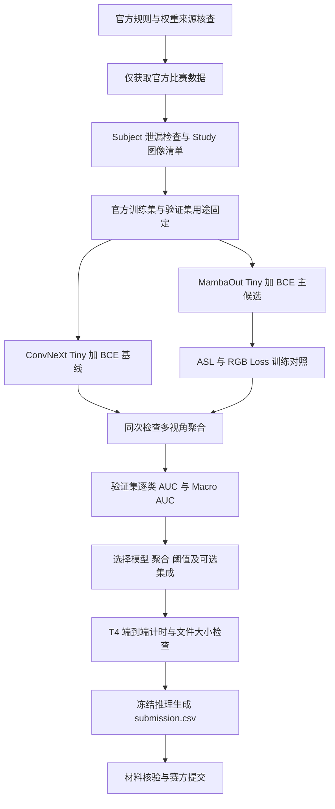

# 胸片多标签分类技术路线

赛题：[全国高校计算机能力挑战赛人工智能赛项](https://www.ncccu.org.cn/index/Paper/case1.html)。本路线为待实施设计，没有成绩和速度承诺。优先目标是截止前交付稳定、可复核的提交。

## 1. 建模对象与主路线

一次检查 `s` 含 `n_s` 张图像，官方标签为 `y_s ∈ {0,1}^10`。共享视觉骨干提取每张图像的特征 `h_sj = fθ(x_sj)`，分类头输出 `z_sj = W h_sj + b`。

起步方案采用固定概率均值：

`p_sc = (1/n_s) Σ_j sigmoid(z_sjc)`。

对照方案为 logit 均值后 Sigmoid；二者不等价，应在验证集选定。不能只取第一张图而忽略 Study 内其他图像，也不能把一个患者的不同检查默认合成一个提交对象。

**主候选：MambaOut-Tiny + 10 类头 + Study 内聚合。** 基线为 ConvNeXt-Tiny；有时间再比较 DINOv2 Small + Registers。先完成 BCE 对照，再试 ASL 和 RGB Loss。输入从 224/288 起步，320/384 由验证收益和 T4 延迟共同决定。

## 2. 流程图

独立源文件：[pipeline.mmd](pipeline.mmd)。

## 3. 训练策略

基线采用 `BCEWithLogitsLoss`，不是单标签交叉熵。类别加权只按官方训练集统计。先保留验证集用于选模型，采用固定训练预算与早停规则；不从测试分布估计类别先验。

多图训练有两种可比较的实现：逐图沿用 Study 标签更简单，但属于弱标签近似；Study 级多实例训练先聚合图像概率或特征，再对 `y_s` 求损失，标签粒度更一致。优先完成简单方案，再用一个固定实验验证 Study 级训练是否有收益。

训练建议采用 AdamW、预训练骨干较小学习率、新分类头较大学习率、混合精度和固定种子。可从骨干 `1e-5~1e-4`、分类头其 5~10 倍、真实 batch=2~8 的小试开始；这些是待调参的工程起点，不是作者复现参数或8GB可运行保证。

小 batch 使用 RGB 时应特别检查低频正样本参考不足、梯度数值和训练稳定性；梯度累计不会扩大单次前向中的参考样本集合。若无稳定收益，保留 BCE/ASL。RGB 来自 [MICCAI 2026 文献](https://papers.miccai.org/miccai-2026/0870-Paper0566.html)，不是本团队原创损失。

## 4. 可以加入的研究分支

| 分支 | 进入条件 | 验证重点 |
| --- | --- | --- |
| 2026 RGB 损失 | BCE/ASL 基线完成，许可和实现已核查 | 少数类 AUC、batch 敏感性、数值稳定性 |
| DINOv2 异构骨干 | 有剩余算力 | 与 CNN 的错误是否互补，而非只看单模型分数 |
| 固定双模型融合 | 同一验证集证明有收益，包大小和耗时留有余量 | 共享全部预处理，完整流程复测 |
| 官方训练集自监督 | 截止前预算充足 | 补充规则允许；仅官方训练图像，不接触外部医学或测试集 |
| 合规教师蒸馏 | 教师与学生权重链均符合规则 | 教师来源、蒸馏关系可追溯；教师不推理可不计部署大小 |

不将医学预训练教师、外部医学伪标签、测试时训练纳入路线。参考 CHASE/DARC 的思想时，只使用官方已提供的标签和元数据，不引入其额外医学数据。

## 5. 部署与提交

推理使用固定参数、eval 模式、固定预处理和 Study 聚合。逐类阈值只影响 F1，不能提高 AUC；优先优化 AUC 排序。最终概率保持足够精度，不先二值化再提交。

首先跑单模型 FP16；T4 不支持与新显卡相同的 BF16 执行能力，不能把本机 BF16 方案直接当成部署方案。集成、固定 TTA、导出 ONNX/TensorRT 都要测完整耗时和结果一致性，不能把吞吐率换算成 batch=1 端到端成绩。

建议由公共 `infer_one`/`predict_study` 模块服务 `predict.py` 与 `cost.py`。多视角时要如实计入所有图像编码和聚合，不隐藏额外前向，不缓存预测代替计时。[计时规则](../06_references/COMPETITION_RULES.md)。

## 6. 截止前排期（北京时间）

| 日期 | 建议完成 |
| --- | --- |
| 11 月 2 日 | 规则与文献冻结，取得官方数据，核实模型权重材料 |
| 11 月 3–4 日 | 数据清单、ConvNeXt 与 MambaOut 基线，生成本地验证预测 |
| 11 月 5–6 日 | ASL/RGB 对照、Study 聚合与逐类分析 |
| 11 月 7–8 日 | 有预算才做 DINOv2/融合；冻结主要选型 |
| 11 月 9–10 日 | T4 计时、大小、推理一致性及环境包 |
| 11 月 11–12 日 | 提交文件和核验材料演练，保留可回退的单模型版本 |
| 11 月 13 日 | 截止 23:59 前完成赛方要求的提交，留上传缓冲 |

这是工作建议，不保证训练天数足够。当前没有官方数据，第一项实施依赖是合法取得比赛数据。演示界面和热力图可以在提交链稳定后补充，不占用本轮主模型验证预算。
